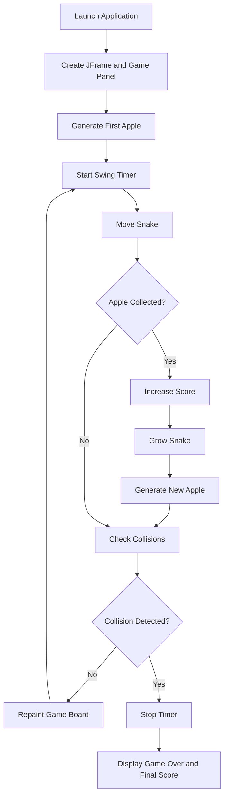

<div align="center">

# 🐍 Snake Game

### Classic Arcade Gameplay Built with Java Swing

**Control the snake, collect apples, grow longer, and survive without hitting the walls or your own body.**

<p>
  
  
  
  
</p>

[Overview](#overview) •
[Features](#features) •
[Controls](#controls) •
[How It Works](#how-it-works) •
[Run Locally](#run-locally) •
[Roadmap](#future-enhancements)

</div>

---

<p align="center">
  
</p>

---

## Overview

**Snake Game** is a lightweight desktop arcade game developed using Java Swing and AWT.

The player controls a continuously moving snake on a grid. Eating a red apple increases the score and adds one segment to the snake. The game ends when the snake touches the edge of the board or collides with its own body.

The complete game is implemented in a single Java source file and uses only Java's standard library.

> **Move → Eat → Grow → Avoid Collisions → Beat Your Score**

---

## Features

- Classic snake movement on a grid
- Arrow-key keyboard controls
- Random apple generation
- Snake growth after eating an apple
- Real-time score display
- Wall-collision detection
- Self-collision detection
- Game-over screen with final score
- Fixed-size centered game window
- No external libraries or assets required

---

## Game Configuration

| Setting | Value |
|---|---:|
| Board width | 600 pixels |
| Board height | 600 pixels |
| Grid-cell size | 25 pixels |
| Grid dimensions | 24 × 24 |
| Total grid cells | 576 |
| Starting snake length | 6 segments |
| Timer delay | 100 milliseconds |
| Approximate update rate | 10 updates per second |
| Starting direction | Right |
| Window resizing | Disabled |

The movement speed remains constant throughout the game.

---

## Controls

| Key | Action |
|---|---|
| <kbd>↑</kbd> | Move up |
| <kbd>↓</kbd> | Move down |
| <kbd>←</kbd> | Move left |
| <kbd>→</kbd> | Move right |

The game prevents an immediate 180-degree turn:

- The snake cannot move left while travelling right.
- The snake cannot move right while travelling left.
- The snake cannot move up while travelling down.
- The snake cannot move down while travelling up.

---

## Gameplay Rules

1. The snake begins with six body segments.
2. It automatically starts moving to the right.
3. Use the arrow keys to change direction.
4. Each collected apple:
   - Increases the score by `1`
   - Adds one segment to the snake
   - Generates a new apple at a random grid position
5. The game ends when:
   - The snake crosses the board boundary
   - The snake's head touches its body
6. The final score appears on the game-over screen.

---

## How It Works



---

## Game Architecture

The `snakegame` class:

```java
public class snakegame extends JPanel
        implements ActionListener, KeyListener
```

It combines three responsibilities:

| Responsibility | Java feature |
|---|---|
| Game board and drawing | `JPanel` and AWT `Graphics` |
| Repeated game updates | Swing `Timer` and `ActionListener` |
| Keyboard input | `KeyListener` |

### Main Game State

```java
private final int[] x;
private final int[] y;
private int bodyParts;
private int applesEaten;
private int appleX, appleY;
private char direction;
private boolean running;
```

The `x` and `y` arrays store the position of every snake segment.

---

## Core Methods

### `startGame()`

- Generates the first apple
- Marks the game as running
- Creates a Swing timer
- Starts the update loop

### `draw(Graphics g)`

- Draws the apple
- Draws the snake head and body
- Displays the current score
- Calls the game-over renderer when the game stops

### `newApple()`

Creates an apple at a random position aligned to the 25-pixel grid.

```java
appleX = random.nextInt(WIDTH / UNIT_SIZE) * UNIT_SIZE;
appleY = random.nextInt(HEIGHT / UNIT_SIZE) * UNIT_SIZE;
```

### `move()`

Moves every body segment to the previous segment's position, then updates the head according to the current direction.

### `checkApple()`

Checks whether the snake head and apple occupy the same grid cell. When they match, the snake grows and the score increases.

### `checkCollisions()`

Detects:

- Collision with the snake's own body
- Collision with the left boundary
- Collision with the right boundary
- Collision with the top boundary
- Collision with the bottom boundary

### `gameOver(Graphics g)`

Displays:

- `Game Over`
- The player's final score

### `keyPressed(KeyEvent e)`

Handles arrow-key input while blocking direct reverse movement.

### `actionPerformed(ActionEvent e)`

Runs once per timer tick:

```text
Move snake
    ↓
Check apple
    ↓
Check collisions
    ↓
Repaint screen
```

---

## Technology Stack

| Category | Technology |
|---|---|
| Programming language | Java |
| User interface | Java Swing |
| Graphics | Java AWT |
| Input handling | AWT KeyListener |
| Game loop | Swing Timer |
| Randomization | `java.util.Random` |
| Build system | Direct `javac` compilation |
| External dependencies | None |

---

## Project Structure

```text
Snake-Game-/
│
├── snakegame.java
├── snakegame.class
└── README.md
```

| File | Purpose |
|---|---|
| `snakegame.java` | Complete source code for gameplay, rendering, controls, and application startup |
| `snakegame.class` | Compiled Java bytecode |
| `README.md` | Project documentation |

> The `.class` file is generated during compilation and normally should not be committed to source control.

A recommended `.gitignore` entry is:

```gitignore
*.class
```

---

## Run Locally

### Prerequisites

Install a Java Development Kit.

Verify the installation:

```bash
java -version
javac -version
```

A modern JDK such as Java 8 or later should be sufficient because the project uses standard Swing and AWT APIs.

### 1. Clone the Repository

```bash
git clone https://github.com/Nithish-code17/Snake-Game-.git
cd Snake-Game-
```

### 2. Compile the Source

```bash
javac snakegame.java
```

This creates:

```text
snakegame.class
```

### 3. Run the Game

```bash
java snakegame
```

A non-resizable 600 × 600 game window will open in the center of the screen.

---

## Run in an IDE

The project can also be opened in:

- Visual Studio Code with the Java Extension Pack
- IntelliJ IDEA
- Eclipse

Open `snakegame.java` and run its `main()` method.

---

## Visual Design

| Element | Appearance |
|---|---|
| Background | Black |
| Snake head | Bright green |
| Snake body | Darker green |
| Apple | Red circle |
| Score | White text |
| Game-over title | Red text |
| Final score | White text |

The source requests the `Ink Free` font. When that font is unavailable, Java may use a fallback font provided by the operating system.

---

## Current Limitations

- The game has no restart button or restart keyboard shortcut.
- There is no pause and resume feature.
- The movement speed does not increase with the score.
- High scores are not saved.
- The apple can potentially appear on a snake segment.
- There are no sound effects or background music.
- The board does not display grid lines.
- The starting body coordinates are not initialized into a visible horizontal formation.
- The source uses a lowercase class name, which differs from standard Java naming conventions.
- The game logic, rendering, and application startup are contained in one class.
- The compiled `.class` file is committed to the repository.
- There are no automated tests.
- There is no build configuration such as Maven or Gradle.

---

## Future Enhancements

- [ ] Add a restart button or <kbd>R</kbd> shortcut
- [ ] Add pause and resume controls
- [ ] Increase speed as the score grows
- [ ] Save and display the highest score
- [ ] Prevent apples from spawning on the snake
- [ ] Add start and difficulty-selection screens
- [ ] Add sound effects
- [ ] Add multiple themes
- [ ] Add obstacles and levels
- [ ] Add a visible grid
- [ ] Initialize the starting body as a horizontal snake
- [ ] Refactor into separate game, panel, and frame classes
- [ ] Rename the class to `SnakeGame`
- [ ] Add unit tests for collision and apple logic
- [ ] Add Maven or Gradle support
- [ ] Create an executable JAR
- [ ] Add a software license

---

## Learning Outcomes

This project demonstrates:

- Building desktop applications with Java Swing
- Drawing custom shapes using AWT Graphics
- Creating a timer-driven game loop
- Managing keyboard events
- Representing a moving object with coordinate arrays
- Implementing grid-based movement
- Detecting object and boundary collisions
- Updating and rendering game state
- Structuring a basic event-driven Java program

---

## Author

<div align="center">

### Nithish Sarwin

Artificial Intelligence & Machine Learning Student  
Java and Backend Developer

[GitHub](https://github.com/Nithish-code17) ·
[LinkedIn](https://linkedin.com/in/nithishsarwin) ·
[Email](mailto:mnithishsarwin@gmail.com)

</div>

---

<div align="center">

**A beginner-friendly Java project that brings the classic Snake experience to the desktop.**

⭐ Star the repository and challenge yourself to beat your highest score.

</div>
